<a href="https://joshwright22.github.io/"></a>

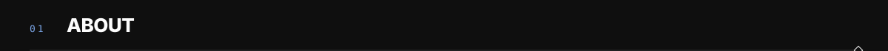

Hey, I'm Josh. I'm an AI engineer graduating from Arizona State University in May 2027 with a B.S. in Computer Science. I build AI systems people actually use, like vision models for motion capture and agents trained on custom GPU simulators. At my internship at UNOMi I fine-tune the vision models behind markerless motion capture and host them on Microsoft Azure. I started out keyframing characters by hand, so animation is where I want to take AI research next.

**Looking for:** new grad software engineering roles starting May 2027, especially machine learning, computer vision, graphics, animation tools, gameplay and R&D at animation studios.

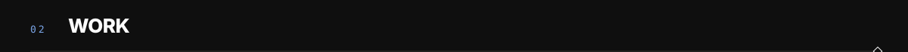

<table>
<tr>
<td width="50%"><a href="https://joshwright22.github.io/projects/unomi/">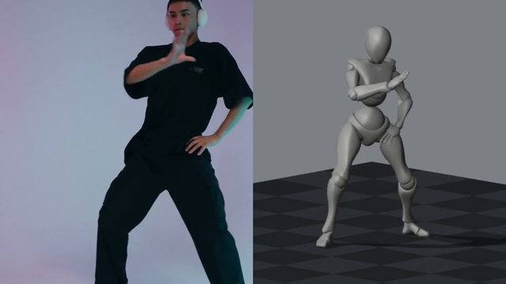</a> <b>UNOMi</b> Two-time Emmy-nominated studio · SWE Internship, Aug 2026 - Present</td>
<td width="50%"><a href="https://joshwright22.github.io/projects/trust-no-one/">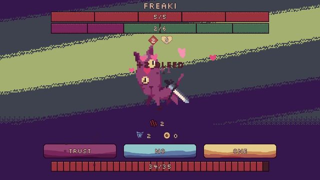</a> <b>Trust No One</b> Placed #9 of 2,253 games · Unity, C#</td>
</tr>
<tr>
<td><a href="https://joshwright22.github.io/projects/theres-no-place-like-127-0-0-1/">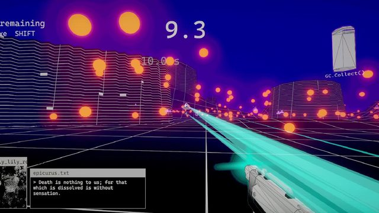</a> <b>There's No Place Like 127.0.0.1</b> Highest scored pitch at the AZ Game Cup · Unity, C#</td>
<td><a href="https://joshwright22.github.io/projects/3d-animation-reel/">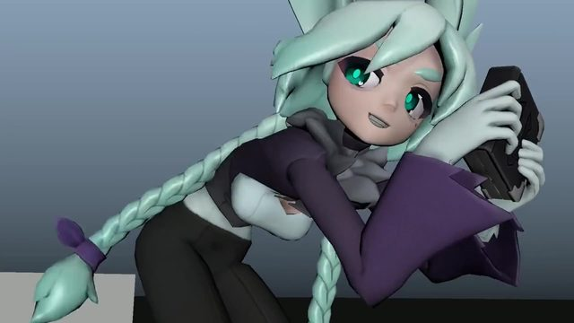</a> <b>3D Animation Reel</b> TV quality animation · Maya</td>
</tr>
<tr>
<td><a href="https://joshwright22.github.io/projects/game-dev-club-club/">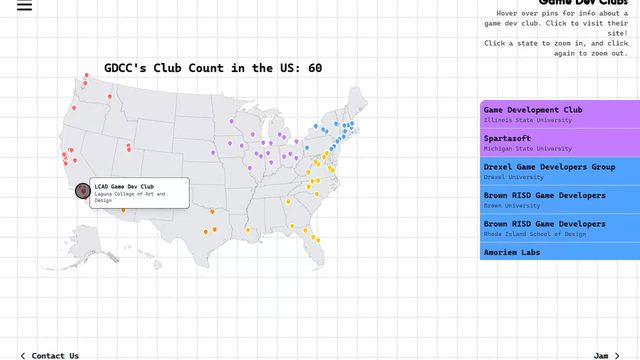</a> <b>Game Dev Club Club</b> Created a club across 104 universities · React</td>
<td><a href="https://joshwright22.github.io/projects/atomoc-shelis/">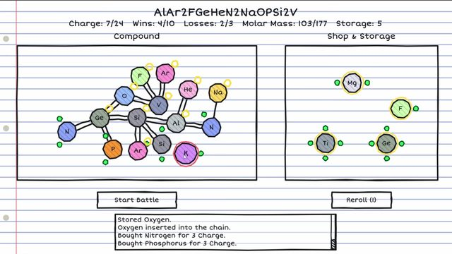</a> <b>AtOMoC SHeLiS</b> Placed #12 of 150 games · Godot</td>
</tr>
<tr>
<td><a href="https://joshwright22.github.io/projects/gob-spin/">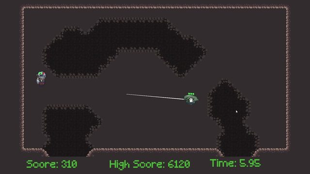</a> <b>Gob Spin</b> Placed #140 of 3,498 games · Unity, C#</td>
<td><a href="https://joshwright22.github.io/projects/slush-rush/">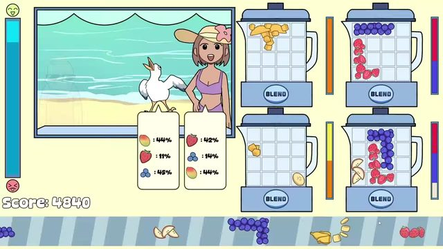</a> <b>Slush Rush</b> Placed #69 of 434 games · Godot</td>
</tr>
</table>

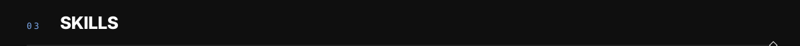

| | |
|---|---|
| **AI Systems** | PyTorch · CUDA · Python · Computer Vision · Machine Learning · Model Fine-Tuning · Reinforcement Learning · AI Agents · MCP · Go |
| **Animation Tools** | Python · Plugin Development · Maya · Blender · Cinema 4D · Unreal Engine · Keyframe Animation · Character Animation · Rigging |
| **Gameplay Systems** | C# · C++ · Unity · Godot · Unreal Engine · Procedural Generation · Multiplayer Networking · Steamworks API |
| **Software Engineering** | C++ · TypeScript · WebGPU · SDL3 · HLSL · React · Next.js · Electron · PostgreSQL · Docker · Azure · AWS · Git |

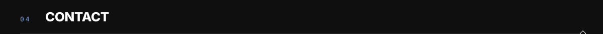

**[Portfolio](https://joshwright22.github.io/)** · **[Email](mailto:joshwright0322@gmail.com)** · **[LinkedIn](https://www.linkedin.com/in/joshua-wright-a94143338/)** · **[YouTube](https://www.youtube.com/@JoshWright_Dev)** · **[X](https://x.com/joshwright_dev)** · **[Instagram](https://www.instagram.com/joshwrightisoninsta/)**
